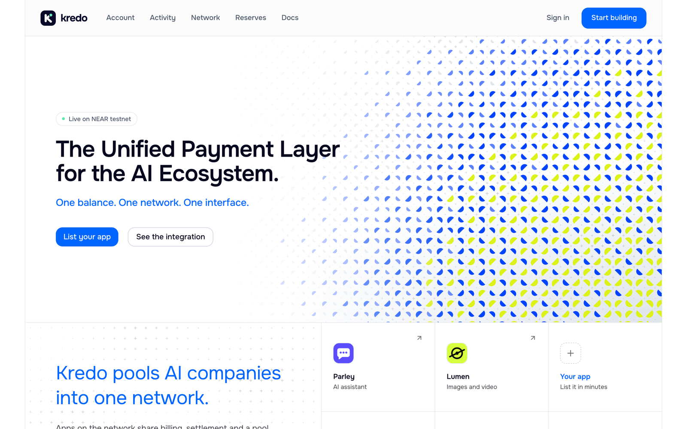
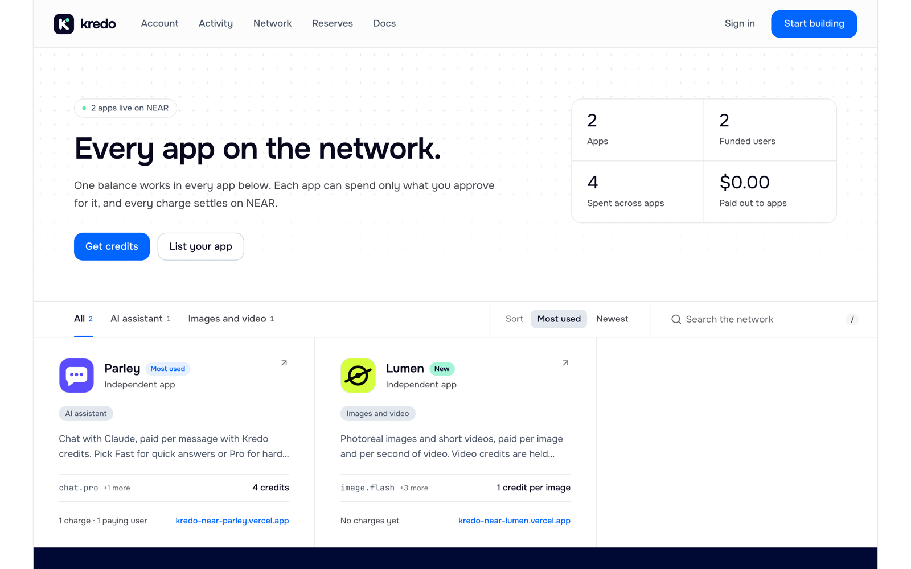

# Kredo

**One balance for a whole ecosystem of apps.**

Today every AI app wants its own top-up. With Kredo you add money once and it works everywhere: chat in one app, make images in another, all from the same balance. You pay only for what you use, down to one cent a message. And it's real money the whole way: your balance is backed 1:1 by USDT in a vault on NEAR, and each app is paid in USDT for exactly what its users spend.



| | |
|---|---|
| App | [kredo-near.vercel.app](https://kredo-near.vercel.app) · [docs](https://kredo-near.vercel.app/docs) |
| Apps in the ecosystem | [Parley](https://kredo-near-parley.vercel.app) (AI chat) · [Lumen](https://kredo-near-lumen.vercel.app) (AI images) |
| API | [kredo-near-api.onrender.com/v1/health](https://kredo-near-api.onrender.com/v1/health) |
| Packages | [`kredo`](https://www.npmjs.com/package/kredo) · [`kredo-react`](https://www.npmjs.com/package/kredo-react) |
| Demo video | [60-second demo on X](https://x.com/fixerpabo_13/status/2121689009042911403) |

## Try it in two minutes

Everything runs on NEAR testnet, so it costs nothing.

1. Open [kredo-near.vercel.app/buy](https://kredo-near.vercel.app/buy) and sign in with your email. A NEAR wallet is made for you: nothing to install, no seed phrase.
2. Take the free test USDT (0.5 USDT, once per account) and buy credits. 1 USDT buys 100 credits, so a credit is one cent.
3. Open [Parley](https://kredo-near-parley.vercel.app), connect Kredo and send a message. Your balance drops, and the charge is a transaction on NEAR.
4. Open [Lumen](https://kredo-near-lumen.vercel.app) and make an image. It comes out of the same balance.
5. Open [Reserves](https://kredo-near.vercel.app/reserves) to see the USDT the vault holds against everything it owes, read from the contract.

## We can't touch your money

On NEAR, every app gets its own account with a key that does one job: billing that app's own users. Nobody else can charge you. Not another app. Not us.

We tested it. We tried to charge a user with Kredo's own operator key, and the vault refused with "Not app signer". [Here is that transaction.](https://testnet.nearblocks.io/txns/AgSRAP9rGkiWWV458ayiSSDvoSkUS424G8ptZfAaGqNv)

## Why NEAR

- **Keys with one job.** Each app has a sub-account (`<app id>.apps.kredo-network.testnet`) holding a single function-call key. It can call `charge`, `hold`, `capture`, `release` and `refund` on the vault, and nothing else.
- **Zero gas.** Users and apps sign NEP-366 meta-transactions and a relayer pays. It can't change what was signed.
- **Email login.** An embedded NEAR wallet, made at sign-in. Only the user can sign with it.
- **Any chain in.** Pay with USDC on Base, ETH, SOL or BTC through NEAR Intents, which swaps it into USDT and delivers it to the vault. On testnet this is a preview with live prices and nothing to pay, because NEAR Intents is mainnet-only.
- **One-cent payments that settle.** A charge costs a fraction of a cent in gas, so a 1-credit message goes on chain.
- **Storage paid by whoever adds it (NEP-145).** A deposit to an account that hasn't registered is refunded in full.

## The ecosystem today

Two apps share one balance, and every new app makes that balance more useful for every user.



Adding yours is one call:

```ts
import { Credits } from "kredo";

const credits = new Credits({
  apiKey: process.env.CREDITS_API_KEY,
  signerKey: process.env.CREDITS_SIGNER_KEY, // your app's NEAR key: only it can charge for your app
});

await credits.charge({ user, action: "chat.message", ref: messageId });
```

Register an app on the [dashboard](https://kredo-near.vercel.app/dashboard). The full API is in the [docs](https://kredo-near.vercel.app/docs) and the [SDK README](packages/sdk/README.md), and the smallest app is [examples/starter](examples/starter/server.ts).

## Proof on chain (testnet)

Vault [`vault-v2.kredo-network.testnet`](https://testnet.nearblocks.io/address/vault-v2.kredo-network.testnet) · test USDT [`usdt.kredo-network.testnet`](https://testnet.nearblocks.io/address/usdt.kredo-network.testnet) · all addresses in [contracts/deployments/testnet.json](contracts/deployments/testnet.json).

| What happened | Transaction |
|---|---|
| Vault deployed | [`BesTcca…vUAL`](https://testnet.nearblocks.io/txns/BesTccaHC9MdESr9yx5wMKSvrXZDQtnMAU4prjcwvUAL) |
| An app's signer created with one function-call key | [`56vbreC…D47`](https://testnet.nearblocks.io/txns/56vbreCdTyGs7wWf8k8Hm9CMCPoCP5MaVxuatGY78D47) |
| An app charges its user (the relayer pays the gas) | [`9m4557D…e7n`](https://testnet.nearblocks.io/txns/9m4557DaNcpKM43pYUJRXK6EuJm6XbjKbZVdveBR7e7n) |
| Hold 3 credits, capture 2, return 1 | [`9vQ3buz…Nqc`](https://testnet.nearblocks.io/txns/9vQ3buz2EWRtB8q5jt9UJyZw9Ph1o2fuESLjnm1AWNqc) |
| **Kredo's operator tries to charge: refused** ("Not app signer") | [`AgSRAP9…qNv`](https://testnet.nearblocks.io/txns/AgSRAP9rGkiWWV458ayiSSDvoSkUS424G8ptZfAaGqNv) |
| **A send to an unregistered account: refused** | [`7VEcjsT…yMh`](https://testnet.nearblocks.io/txns/7VEcjsTcYLuvxBcJh6mBSnYVko8Xbxbd4jrY78aH9yMh) |

## Who can move money

| Who | Can | Can't |
|---|---|---|
| Kredo's operator (relayer) | pay gas, register apps, pause, release holds | charge, refund, change fees, payouts or signers |
| Kredo's owner | set an app's fee (max 20%), manage operators, withdraw network fees | charge, change an app's payout or signer |
| An app's signer key, if leaked | charge that app's users, within the limits they approved | touch other apps, move USDT or NEAR, add keys |
| An app's payout account | rotate the signer (`set_app_signer`), move the payout | — |

The SDK also checks each prepared transaction before signing: hash, key, method, user and ref.

## Run it

Needs Node 22, Rust with `cargo-near`, `near-cli-rs` and `jq`, plus a [Privy](https://dashboard.privy.io) app with email login and NEAR embedded wallets.

```bash
npm install
cp apps/api/.env.example apps/api/.env    # PRIVY_APP_ID, PRIVY_APP_SECRET, RELAYER_PRIVATE_KEY
cp apps/web/.env.example apps/web/.env    # NEXT_PUBLIC_PRIVY_APP_ID
npm run contracts:build && npm run contracts:test
npm run dev:local                         # API :4000, app :3000, against the testnet vault
npm run test:api && npm run test:sdk      # end to end against an in-memory NEAR chain
```

Demos: `npm run demos:keys`, then `node scripts/create-app-signer.mjs <app id> --env demos/parley/.env.local`, then `npm run dev:parley`. Deploy settings are in [render.yaml](render.yaml) and each app's `.env.example`. Mainnet vault and a real cross-chain buy: `npm run deploy:mainnet`, then `npm run intents:buy` (written, not yet run).

| Path | What |
|---|---|
| [contracts](contracts) | Vault and test USDT in Rust, 61 unit tests |
| [apps/api](apps/api) | REST API, relayer, indexer, webhooks, NEAR Intents |
| [apps/web](apps/web) | Landing, buy, connect, account, dashboard, reserves, docs |
| [packages](packages) | `kredo` (server SDK) and `kredo-react` |
| [demos](demos) · [examples](examples) | Parley, Lumen and the starter app |

## What isn't done yet

- Testnet only, not audited.
- Kredo still holds the vault account's full-access key, so it could deploy new code. Removing it or putting it behind a multisig is the mainnet step.
- Parley and Lumen pay out to Kredo's owner account, so Kredo can rotate their signers. A real company's app pays out to its own account.
- NEAR Intents is a preview on testnet; the mainnet path hasn't been run.
- Users can't cash credits out to USDT; only apps are paid out. Storage isn't refunded when state shrinks.

## Where it came from

We began Kredo at **ETHGlobal Mumbai** (5–7 Nov 2026) and didn't get to finish what we had in mind. We kept building it at this hackathon, this time on NEAR.

That first version ran on Whitechain, an EVM chain, with a Solidity vault ([kredo-omega.vercel.app](https://kredo-omega.vercel.app), `kredo@0.1.x` on npm). The history keeps the two apart: the EVM build's 85 commits end at tag [`ethglobal-final`](https://github.com/chandrabosep/near-hacks-kredo/tree/ethglobal-final), and everything after it is NEAR work, committed on 13 and 14 Nov.

| | |
|---|---|
| This submission | tag [`hackathon-final`](https://github.com/chandrabosep/near-hacks-kredo/tree/hackathon-final) |
| Everything that changed for NEAR | [`ethglobal-final...hackathon-final`](https://github.com/chandrabosep/near-hacks-kredo/compare/ethglobal-final...hackathon-final) |
| First cut of the NEAR version (v1 vault, 13 Nov 18:11) | tag [`hackathon-submission`](https://github.com/chandrabosep/near-hacks-kredo/tree/hackathon-submission) |

New for NEAR: the vault rewritten in Rust, NEP-141 test USDT, app signers, NEP-145 storage, the NEP-366 relayer, Privy NEAR wallet signing, events read from transaction outcomes, NEAR Intents, and an in-memory NEAR chain for tests. The hosted pages, dashboard, SDK surface and demos were carried over and adapted.

**Built with** near-sdk, near-api-js, NEAR Intents 1Click, FastNEAR and dRPC, NearBlocks, Next.js, Express, Drizzle on Postgres, Privy, Vercel and Render.

**AI-assisted.** Most of the code was written with [Claude Code](https://claude.com/claude-code) under our direction: we set the design, reviewed the changes, and ran and tested them. 56 of the 85 EVM commits and every NEAR commit carry a `Co-Authored-By: Claude` trailer.

[MIT](LICENSE)
